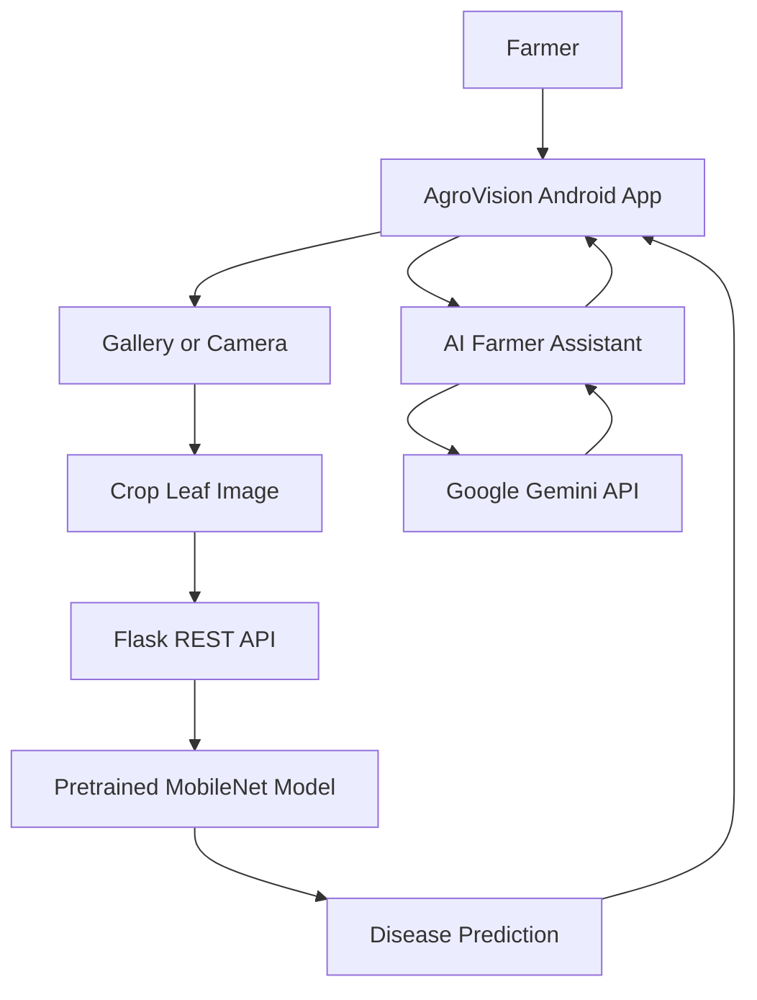

# 🌾 AgroVision Sindh
### AI-Powered Crop Disease Detection & Farmer Assistance

<p align="center">

**An AI-powered mobile solution designed to help farmers identify crop diseases and access agricultural guidance.**

</p>

<p align="center">


</p>

---

## 📌 Overview

**AgroVision Sindh** is an AI-powered Android application developed to support farmers in identifying possible crop diseases from leaf photographs and accessing agricultural information through an AI Farmer Assistant.

The application combines a pretrained MobileNet image-classification model with a Python Flask API and an Android mobile interface. It also integrates Google Gemini for AI-powered agricultural conversations.

The goal is to make AI-assisted crop health screening more accessible, particularly for farmers who may have limited access to agricultural expertise.

## 🎯 Problem Statement

**AG-01 — AI Crop Disease Scout**

Farmers may struggle to identify crop diseases at an early stage, while access to agricultural experts can be limited in rural communities.

AgroVision Sindh aims to address this challenge by providing an accessible mobile interface for crop leaf image analysis and agricultural assistance.

## ✨ Key Features

### 1. 📷 Crop Disease Detection
- Select a crop leaf photograph from the device gallery.
- Capture a leaf photograph directly using the camera.
- Send the image to the Flask backend for analysis.
- Use a pretrained MobileNet model to generate a prediction.
- Display the predicted disease or healthy status returned by the model.

### 2. 🤖 AI Farmer Assistant
- Ask agricultural questions through the existing AI chat interface.
- Use Google Gemini integration to generate responses.
- Access agricultural guidance through a conversational interface.
- Support Sindhi, Urdu, and English text where implemented.
- Provide voice input and spoken responses according to the configured language and device speech-engine capabilities.

### 3. 📱 Android Application
- Native Android application developed using Java.
- Dedicated screens for image analysis, results, and AI chat.
- Language-specific Android resources for English, Urdu, and Sindhi.
- Communication with the backend through HTTP API requests.

### 4. 🧠 Pretrained Machine Learning Model
- MobileNet-based image classification.
- TensorFlow and Keras model loading and inference.
- Image preprocessing before prediction.
- Model inference handled by the Python backend.

> **Note:** Prediction accuracy, supported crops, and disease classes depend on the model's training dataset and evaluation. The application should not be treated as a replacement for professional agricultural diagnosis.

---

## 🏗️ Technology Stack

| Component | Technology | Purpose |
|---|---|---|
| Mobile application | Android SDK, Java | Mobile interface and application logic |
| UI | Android XML layouts | Screens, forms, and controls |
| Backend API | Python, Flask | Receives images and serves application requests |
| Machine learning | TensorFlow, Keras | Loads and runs the pretrained model |
| Image classification | MobileNet-based model | Predicts crop health or disease class |
| AI assistant | Google Gemini API | Conversational agricultural assistance |
| Voice features | Android speech APIs, where implemented | Speech recognition and text-to-speech |
| Version control | Git, GitHub | Source code management and collaboration |

---

## 🔄 System Architecture



### How It Works

1. The farmer opens the Android application.
2. The farmer selects an image from the gallery or captures a photograph.
3. The app sends the image to the Flask API.
4. The backend preprocesses the image and runs the pretrained model.
5. The prediction is returned to the app and displayed on the result screen.
6. For agricultural questions, the AI Farmer Assistant uses the existing Gemini integration.

---

## 📂 Project Structure

```text
AgroVision-Sindh/
├── android/
│   └── app/
│       └── src/
│           ├── main/
│           │   ├── java/com/agrovision/sindh/
│           │   │   ├── MainActivity.java
│           │   │   ├── ResultActivity.java
│           │   │   ├── ApiClient.java
│           │   │   ├── LanguageManager.java
│           │   │   ├── ChatActivity.java
│           │   │   └── voice/
│           │   └── res/
│           │       ├── layout/
│           │       ├── drawable/
│           │       ├── values/
│           │       ├── values-ur/
│           │       └── values-sd/
│           └── test/
├── backend/
│   ├── app.py
│   ├── ai_assistant.py
│   ├── test_chat_api.py
│   ├── model_4_mobilenet_finetuned.keras
│   └── requirements.txt
├── README.md
└── .gitignore
```

*This is a representative structure based on the project files; retain only paths that exist in your current repository.*

---

## ⚙️ Installation & Setup

### Prerequisites

- Python installed on your computer.
- Android Studio and a compatible Android SDK.
- Git.
- A Google Gemini API key for the AI assistant.
- The pretrained model file required by the backend.

### 1. Clone the repository

```bash
git clone https://github.com/IbrarUjn/AgroVision-Sindh.git
cd AgroVision-Sindh
```

### 2. Set up the Python backend

Open a terminal in the project directory:

```powershell
cd backend
py -m venv .venv
```

Activate the environment on Windows:

```powershell
.\.venv\Scripts\Activate.ps1
```

Install the backend dependencies:

```powershell
py -m pip install -r requirements.txt
```

Start the Flask API:

```powershell
py app.py
```

The backend is configured to listen on port `5000`. A successful startup should indicate that the model loaded and the Flask server started.

### 3. Connect the Android application

Open the `android` project in Android Studio, allow Gradle synchronization to complete, and run the app on an emulator or physical Android device.

Configure the API base URL according to the device:

| Environment | Example API base URL |
|---|---|
| Android Studio emulator | `http://10.0.2.2:5000` |
| Physical phone on the same Wi-Fi | `http://YOUR_PC_IP:5000` |
| Physical phone using USB reverse | `http://127.0.0.1:5000` |

For USB reverse, configure Android Debug Bridge with:

```bash
adb reverse tcp:5000 tcp:5000
```

Replace `YOUR_PC_IP` with the computer's actual local IPv4 address. Keep the Flask server running while testing.

**Security:** Plain HTTP is suitable only for controlled local development. Use HTTPS and appropriate access controls for a production deployment.

---

## 🔐 Configuration & Security

- Keep API keys and credentials out of source code.
- Use environment variables or an appropriate secrets-management solution for the Gemini API key.
- Do not commit `.env` files, passwords, private credentials, or generated build artifacts.
- Restrict development server access to trusted networks.
- Verify the source, license, and permitted use of the pretrained model before redistribution.

Example `.gitignore` entries:

```gitignore
.env
.env.*
!.env.example
.venv/
__pycache__/
*.pyc
build/
.gradle/
local.properties
```

Review existing ignore rules before modifying them. Never upload actual API keys in `.env.example`.

---

## 🧪 Testing

Test the following workflows before presenting the project:

- [ ] Select a crop image from the gallery.
- [ ] Capture a crop image using the camera.
- [ ] Confirm that the Flask API receives and processes the image.
- [ ] Verify that the app displays the model's prediction.
- [ ] Test the AI Farmer Assistant using the configured Gemini API.
- [ ] Test supported language and voice combinations on the target device.
- [ ] Check error handling when the backend is unavailable.
- [ ] Verify that API keys and credentials are not included in the repository.

---

## 🚧 Limitations

- Predictions depend on the pretrained model and the images it was trained on.
- Model accuracy must be evaluated using a suitable test dataset.
- The backend must be reachable for features that require server-side inference.
- Gemini features require valid API configuration and network access.
- Urdu and English voice output, as well as Sindhi voice support, depend on the available speech engines and tested implementation.
- Agricultural recommendations should be verified for local crop varieties and conditions.

---

## 🚀 Future Improvements

- Evaluate the model using locally collected crop images.
- Expand and validate crop and disease coverage.
- Improve performance under varying lighting and image conditions.
- Add secure production hosting and API authentication.
- Improve multilingual speech accessibility and low-connectivity support.
- Evaluate the application with farmers and agricultural experts.

---

## 👥 Team

**Creative Tech Brains**

Project: AgroVision Sindh — AI Crop Disease Scout

Category: AgriTech & Food

Hackathon problem: AG-01

Team members:
- [Add registered team member names and GitHub usernames]

---

## 🤝 Contributions

Contributions should follow the project's existing architecture and coding conventions. Test changes before submitting a pull request, and never include secrets or private credentials.

## 📜 License

Add the license that applies to this project and its model dependencies. Do not assume the pretrained model or other dependencies permit redistribution.

## 🔗 Project Links

- **GitHub Repository:** https://github.com/IbrarUjn/AgroVision-Sindh
- **Hackathon:** OpenHack26
- **Category:** AgriTech & Food

---

<p align="center">

**Built to support farmers through accessible AI technology. 🌱**

</p>